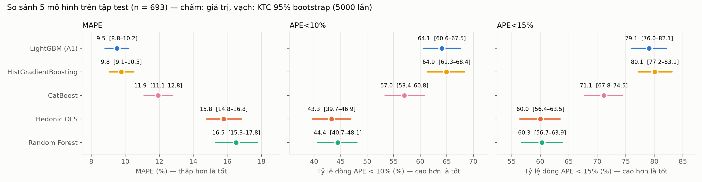

# Dự đoán đơn giá quyền sử dụng đất TP.HCM (đ/m²)

Repo gom toàn bộ quy trình: **dữ liệu gốc → làm sạch → huấn luyện 6 mô hình → so sánh**. Mọi kết quả trong repo là kết quả của lần chạy đã thực hiện (11–12/11/2026), **không phải chạy lại**. Code đi kèm để kiểm tra và tái lập.

- **Target:** `Đơn giá quyền sử dụng đất (đ/m2)1`, huấn luyện trên thang `log1p`.
- **Chia dữ liệu:** train sạch 43.466 dòng → train 34.772 / val 8.694 (ngẫu nhiên 80/20, `SEED = 42`). Test là tập TSTĐ độc lập `tstd` (693 dòng sau làm sạch).
- **Chỉ số chính:** **MAPE** (thấp là tốt), **APE<10%** và **APE<15%** (tỷ lệ dòng có sai số tuyệt đối tương đối dưới ngưỡng, cao là tốt). Các chỉ số khác (R², MAE, RMSE, MdAPE, sai số có dấu, APE<20%) nằm trong `03_so_sanh/ket_qua.xlsx`.
- **Siêu tham số:** chọn bằng 6 cấu hình ngẫu nhiên mỗi mô hình, **chỉ dựa trên Val MAPE**, không nhìn test.

## Kết quả chính (tập test, n = 693)

Giá trị kèm khoảng tin cậy 95% bootstrap theo cặp (5.000 lần). Δ là hiệu so với LightGBM.

| Mô hình | MAPE % | APE<10% | APE<15% | R² | Δ MAPE [KTC 95%] | Kết luận so với LightGBM |
|---|---|---|---|---|---|---|
| **LightGBM** (phiên bản A1) | **9,51** [8,81–10,21] | 64,1 | 79,1 | 0,949 | — | — |
| HistGradientBoosting | 9,77 [9,06–10,50] | **64,9** | **80,1** | 0,949 | +0,25 [−0,17; +0,67] | không phân biệt được |
| CatBoost | 11,93 [11,12–12,79] | 57,0 | 71,1 | 0,937 | +2,42 [+1,77; +3,09] | kém hơn có ý nghĩa |
| TabPFN v2 (3 × 10.000 dòng ngữ cảnh) | 12,33 [11,44–13,28] | 56,1 | 70,7 | 0,912 | +2,81 [+2,08; +3,58] | kém hơn có ý nghĩa |
| Hedonic OLS (baseline) | 15,79 [14,79–16,83] | 43,3 | 60,0 | 0,862 | +6,28 [+5,29; +7,30] | kém hơn có ý nghĩa |
| Random Forest | 16,52 [15,31–17,77] | 44,4 | 60,3 | 0,835 | +7,01 [+5,88; +8,23] | kém hơn có ý nghĩa |



**Đọc kết quả**

1. LightGBM và HistGradientBoosting tốt nhất và **không phân biệt được** về thống kê trên cả ba chỉ số chính.
2. CatBoost, TabPFN, Hedonic OLS và Random Forest kém hơn LightGBM có ý nghĩa trên cả ba chỉ số.
3. **Kết quả test có phần lạc quan.** Train có 2.921 dòng quý q2-2026 (cùng quý với test), và 62/693 mã tài sản của test đã có trong train. Khi huấn luyện lại chỉ trên dữ liệu trước q2-2026 (kiểm tra ngoài thời gian), LightGBM còn MAPE 11,97%, APE<10% 55,1%, và dự đoán thấp có hệ thống khoảng 5%.
4. CatBoost và một nửa số cấu hình HGB chạm trần 5.000 vòng, nên hai mô hình này có thể bị đánh giá thấp hơn thực lực.

Phân tích đầy đủ (theo vùng, theo mã có/không có trong train, ngoài thời gian, bỏ nhóm biến, SHAP, sai số theo phân vị và quận) ở [03_so_sanh/tom_tat.md](03_so_sanh/tom_tat.md). Chi tiết TabPFN ở [02_mo_hinh/TabPFN/tom_tat_tabpfn.md](02_mo_hinh/TabPFN/tom_tat_tabpfn.md).

## Cấu trúc repo

```
github_HCM/
├── README.md
├── requirements.txt
├── data/
│   ├── raw/                         # DỮ LIỆU GỐC (không sửa)
│   │   ├── train_HCM_3.xlsx         #   49.889 dòng × 78 cột
│   │   └── tstd_HCM_3.xlsx          #   710 dòng × 67 cột (tập test TSTĐ)
│   └── processed/                   # đầu ra của bước làm sạch
│       ├── train_HCM_3_clean.xlsx   #   43.466 dòng × 42 cột
│       ├── tstd_HCM_3_clean.xlsx    #   693 dòng × 40 cột
│       └── bao_cao_rule*.csv, bang_tra_he_so_hinh_dang.csv, tstd_*.csv
│
├── 01_lam_sach/                     # BƯỚC 1 · QUY TRÌNH LÀM SẠCH
│   ├── README.md                    #   mô tả chi tiết từng rule B0–B9
│   ├── lam_sach.ipynb               #   thư viện rule dùng chung
│   ├── pipeline_lam_sach_train_HCM_3.ipynb
│   └── pipeline_lam_sach_tstd_HCM_3.ipynb
│
├── 02_mo_hinh/                      # BƯỚC 2 · HUẤN LUYỆN MÔ HÌNH
│   ├── a1_common.py                 #   dựng đặc trưng dùng chung (chép từ notebook LightGBM/A1)
│   ├── chay_mo_hinh.py              #   huấn luyện LightGBM, Hedonic OLS, RF, HGB, CatBoost (có checkpoint)
│   ├── log_chay_mo_hinh.txt         #   nhật ký lần chạy
│   ├── checkpoints/                 #   dự đoán + tham số của từng mô hình (.joblib)
│   ├── LightGBM/                    #   mô hình A1: notebook, model đã lưu, kết quả
│   ├── HistGradientBoosting/
│   ├── CatBoost/
│   ├── RandomForest/
│   ├── HedonicOLS/
│   └── TabPFN/                      #   script riêng (cần GPU), kết quả riêng
│
└── 03_so_sanh/                      # BƯỚC 3 · SO SÁNH & PHÂN TÍCH
    ├── phan_tich.py                 #   đọc checkpoint, tính bootstrap, SHAP, xuất bảng và biểu đồ
    ├── tom_tat.md                   #   tóm tắt kết quả + cảnh báo
    ├── ket_qua.xlsx                 #   toàn bộ bảng số (10 sheet)
    ├── bieu_do/                     #   bd1–bd4 *.png
    └── predictions/                 #   dự đoán của mọi mô hình trên train / val / test / ngoài thời gian / bỏ biến
```

Mỗi thư mục mô hình trong `02_mo_hinh/` có `README.md` và `ket_qua/` gồm:

| Tệp | Nội dung |
|---|---|
| `tham_so.json` | siêu tham số được chọn, số vòng, thời gian huấn luyện |
| `tim_kiem_sieu_tham_so.csv` | 6 cấu hình đã thử và Val MAPE của từng cấu hình (RF, HGB, CatBoost) |
| `chi_so_danh_gia.csv` | R², MAE, RMSE, MAPE, MdAPE, APE<10/15/20% theo tập (Train/Val/Test) và vùng (HCM1/HCM2) |
| `predictions_val.csv`, `predictions_test.csv` | giá thực tế, dự đoán và APE % từng dòng |

Dự đoán trên tập train của mọi mô hình nằm chung trong `03_so_sanh/predictions/predictions_train.csv`.

## Đặc trưng đầu vào

Mọi mô hình (trừ TabPFN và Hedonic OLS) dùng cùng bộ **646 đặc trưng** dựng trong `02_mo_hinh/a1_common.py`:

- 7 biến phân loại: Xã/Phường, Vùng, Đường phố, Vị trí trong khung giá, Quý_Năm, Lợi thế kinh doanh, `hinh_dang_sach`
- 6 biến số: Diện tích, Mặt tiền, Chiều dài, Số mặt tiền tiếp giáp, Độ rộng ngõ, Khoảng cách đến đường chính
- Cột Chi tiết → 33 cột: 9 cờ từ khoá + 24 thành phần SVD của TF-IDF (từ và ký tự)
- Cột Yếu tố khác → 600 cột TF-IDF (từ 1–2)

**Không dùng** biến tính từ đơn giá (`Don_gia_TB`, `Min`, `Max`, `Độ lệch chuẩn`, `Số lượng mẫu`) để tránh rò rỉ target, và không dùng ba cột `Chi_so_*`. Danh sách đầy đủ trong `02_mo_hinh/LightGBM/model/manifest.json`.

Cách mỗi mô hình xử lý biến phân loại khác nhau, ghi trong README của từng mô hình.

## Tái lập

```bash
pip install -r requirements.txt
```

| Bước | Lệnh | Thời gian (máy chạy gốc) |
|---|---|---|
| 1. Làm sạch | chạy `01_lam_sach/pipeline_lam_sach_train_HCM_3.ipynb`, rồi `pipeline_lam_sach_tstd_HCM_3.ipynb` | 3–6 phút |
| 2a. LightGBM (A1) | chạy `02_mo_hinh/LightGBM/pipeline_LightGBM.ipynb` | ~2 phút huấn luyện |
| 2b. Các mô hình còn lại | `python 02_mo_hinh/chay_mo_hinh.py` | ~2 giờ nếu chạy từ đầu |
| 2c. TabPFN (cần GPU) | `python 02_mo_hinh/TabPFN/chay_tabpfn.py main`, rồi `python 02_mo_hinh/TabPFN/bao_cao_tabpfn.py` | ~1 giờ trên RTX 3050 4 GB |
| 3. So sánh | `python 03_so_sanh/phan_tich.py` (chỉ đọc checkpoint) | — |

**Checkpoint.** `chay_mo_hinh.py` lưu dự đoán của từng mô hình vào `02_mo_hinh/checkpoints/*.joblib` và bỏ qua mô hình đã có checkpoint. Repo đã kèm checkpoint dự đoán của các lần chạy gốc, nên chạy lệnh 2b chỉ dựng lại đặc trưng mà không huấn luyện lại. Xoá file `m_<mô hình>.joblib` tương ứng để huấn luyện lại một mô hình.

**Không có trên GitHub** (do kích thước, xem `.gitignore`):

- `02_mo_hinh/checkpoints/features_*.joblib`: ma trận đặc trưng, tự sinh lại khi chạy `chay_mo_hinh.py`.
- `02_mo_hinh/LightGBM/model/lightgbm_model.txt` (110 MB, vượt giới hạn 100 MB của GitHub). Repo chứa bản nén `lightgbm_model.txt.gz` (37,5 MB). Giải nén trước khi dùng:

  ```bash
  gunzip -k 02_mo_hinh/LightGBM/model/lightgbm_model.txt.gz
  # phan_tich.py (SHAP) đọc model ở checkpoints/models/, cùng một file:
  mkdir -p 02_mo_hinh/checkpoints/models
  cp 02_mo_hinh/LightGBM/model/lightgbm_model.txt 02_mo_hinh/checkpoints/models/lightgbm_A1.txt
  ```

## Môi trường đã chạy

Python 3.14.4 · pandas 3.0.5 · numpy 2.5.2 · scikit-learn 1.9.0 · lightgbm 4.7.0 · catboost 1.2.10 · tabpfn 9.2.0 · torch 2.13.0 (CUDA 12.6). Windows 11, CPU 16 luồng, GPU RTX 3050 4 GB (chỉ dùng cho TabPFN).

## Ghi chú

- Tên **LightGBM** trong repo này chính là **phiên bản A1**. Trong các file kết quả, cột và nhãn vẫn ghi `LightGBM (A1)` như lúc chạy.
- Notebook LightGBM nhắc tới phiên bản A (`A/pipeline_HCM_A.ipynb`, pipeline gốc của công ty). File đó không nằm trong repo. A1 khác A ở chỗ dùng dữ liệu đã làm sạch, chỉ dùng LightGBM và bỏ mọi biến tính từ đơn giá (bảng so sánh ở đầu notebook).
- Phần output in sẵn trong các notebook còn hiện đường dẫn máy gốc (`D:\HCM2810\...`). Code đã được sửa theo cấu trúc repo này.
